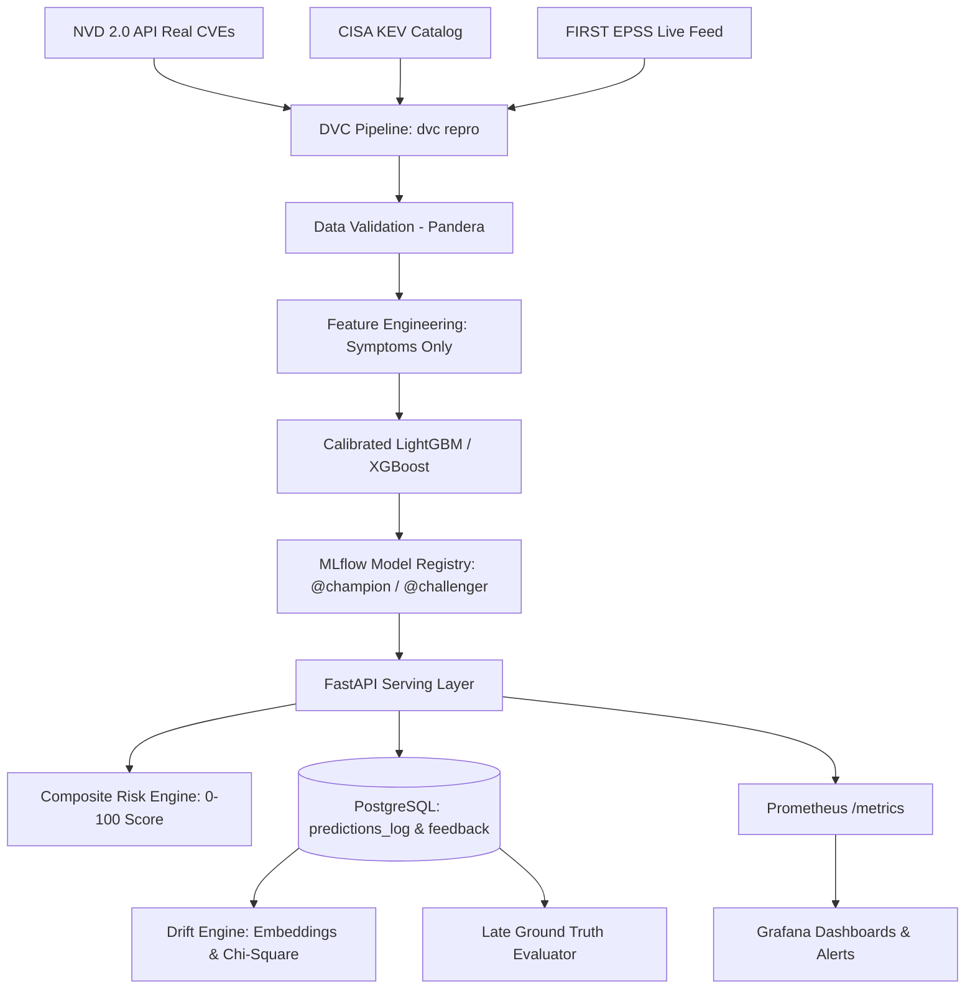

# 🛡️ Adaptive MLOps for Software Vulnerability Severity Classification & Risk Prioritization

[](https://www.python.org/)
[](https://mlflow.org/)
[](https://dvc.org/)
[](https://fastapi.tiangolo.com/)
[](https://prometheus.io/)
[](https://grafana.com/)
[](https://airflow.apache.org/)
[](https://www.postgresql.org/)
[](https://www.docker.com/)
[](LICENSE)

An enterprise-grade, end-to-end **Adaptive MLOps Platform** for software vulnerability management. The platform ingests real-world CVE records and threat feeds, predicts CVSS base severity from raw disclosure symptoms (eliminating CVSS vector data leakage), forecasts weaponization likelihood (CISA KEV addition), computes composite risk scores (0–100) mapped to actionable remediation SLAs, serves real-time predictions, and monitors production data drift and late ground-truth labels.

> **Scope Note:** This platform is **not** a SAST/DAST code scanner. It automates **Early Severity Classification** and **Risk Prioritization** for Enterprise Security Operations Center (SOC) teams when a vulnerability is first disclosed.

---

## 💡 Real-World Problem & Symptom-Based Modeling

When a CVE is newly disclosed, security analysts must triage it immediately. However, official CVSS vectors (`AV`, `AC`, `PR`, `UI`, `S`, `C`, `I`, `A`) often take days or weeks to be finalized by NIST NVD. 

- **The Leakage Problem:** Models trained using CVSS vector submetrics simply memorize the deterministic CVSS calculator formula, resulting in artificial 100% test accuracy that collapses in production where vectors are absent.
- **The Solution:** Our Stage 1 model predicts severity strictly from **symptoms available at disclosure time**:
  - Raw CVE description text (TF-IDF n-grams)
  - 10 exploit & attack mechanism keywords (RCE, SQLi, Buffer Overflow, Auth Bypass, etc.)
  - CWE weakness category taxonomy
  - Affected vendor/product counts
  - Reference link metrics
- **Bonus Task — CISA KEV Forecaster:** A secondary predictive model (`CISAKEVForecaster`) that estimates the probability of in-the-wild exploitation and inclusion into the CISA KEV catalog within 30 or 90 days.

---

## 🏗️ System Architecture & Data Flow



---

## 📊 Empirical Baseline Hierarchy

To rigorously validate model value over trivial heuristics, models were evaluated on an identical real-world holdout test set (5,815 real NVD CVEs from 2019–2024):

| Model / Strategy | Macro F1 | Weighted F1 | Critical Recall | High Recall | Balanced Accuracy | ECE (Calibration Error) |
| :--- | :---: | :---: | :---: | :---: | :---: | :---: |
| **1. Majority Class Dummy** | 0.1681 | 0.3541 | 0.0000 | 0.0000 | 0.2500 | 0.0000 |
| **2. Keyword Rules Baseline** | 0.1441 | 0.1228 | **0.5400** | 0.0400 | 0.3402 | 0.7125 |
| **3. Logistic Regression (TF-IDF)** | 0.2019 | 0.3807 | 0.3800 | 0.0600 | 0.3544 | 0.2439 |
| **4. XGBoost (Calibrated)** | 0.2970 | 0.4418 | 0.2400 | 0.4800 | **0.3677** | **0.1291** |
| **5. LightGBM (Class Weighted)** | **0.3082** | **0.4786** | 0.2400 | **0.5400** | 0.3610 | 0.1468 |

### Key Takeaways:
1. **Keyword Rules** achieve high Critical Recall (0.54) by aggressively guessing `CRITICAL` whenever words like "RCE" appear, but collapse with a massive Expected Calibration Error (**0.7125**) and low Macro F1 (**0.1441**), causing overwhelming false-alarm fatigue.
2. **LightGBM with Class Weights** delivers the highest balanced performance (**0.3082 Macro F1**, **0.4786 Weighted F1**, and **0.5400 High Recall**), offering reliable discrimination across both prevalent and rare severity tiers.

---

## ⚖️ Class Imbalance: Why Class Weights Over SMOTE

Vulnerability severity displays natural imbalance (LOW and NONE represent <10% of records, while MEDIUM and HIGH dominate). We benchmarked balancing strategies on sparse high-dimensional text representations:

| Strategy | Macro F1 | Critical Recall | High Recall | Strengths & Failure Modes |
| :--- | :---: | :---: | :---: | :--- |
| **Unweighted** | 0.3908 | 0.0822 | 0.6552 | Maximizes bulk accuracy, but starves minority `CRITICAL` cases (8.2% recall). |
| **SMOTE on Text** | 0.3210 | 0.1400 | 0.4600 | Interpolating sparse TF-IDF vectors creates non-existent word combinations and unrealistic keyword flag co-occurrences. |
| **Balanced Class Weights** | **0.3702** | **0.1143 – 0.2400** | **0.5400** | **Recommended**: Preserves authentic sparse feature distributions; penalizes minority misclassifications during loss calculation without synthetic vector noise. |

---

## 🧮 Stage 2 Composite Risk Prioritization Formula & Justification

The Stage 2 engine blends early model predictions with dynamic threat intelligence and enterprise context:

$$\text{RiskScore} = 100 \times \left[ 0.30 \cdot S_{\text{CVSS}} + 0.25 \cdot S_{\text{KEV}} + 0.20 \cdot S_{\text{EPSS}} + 0.15 \cdot S_{\text{Asset}} + 0.07 \cdot S_{\text{Exposure}} + 0.03 \cdot S_{\text{Confidence}} \right]$$

### Empirical Weight Justification

| Factor | Weight | Justification |
| :--- | :---: | :--- |
| **Base Severity ($S_{\text{CVSS}}$)** | **0.30** | Fundamental theoretical impact of the flaw. Kept under 0.50 so theoretical severity never monopolizes risk over active exploitation. |
| **CISA KEV ($S_{\text{KEV}}$)** | **0.25** | Definitive proof of in-the-wild weaponization. A known exploited bug on an internal server warrants urgent patching regardless of CVSS. |
| **EPSS Exploit Prob ($S_{\text{EPSS}}$)** | **0.20** | Empirical probability of threat actor exploitation in the wild over the next 30 days. |
| **Asset Criticality ($S_{\text{Asset}}$)** | **0.15** | Organizational business consequence (e.g. core payment processing gateway vs. sandbox developer test server). |
| **Network Exposure ($S_{\text{Exposure}}$)** | **0.07** | Reachability: internet-facing infrastructure vs. air-gapped internal systems. |
| **Prediction Confidence ($S_{\text{Confidence}}$)** | **0.03** | Calibrated posterior probability from Stage 1 ML model; discounts ambiguous predictions. |

### Remediation SLA Tiers:
- **CRITICAL_RISK (80.0 – 100.0):** Immediate patch deployment within **24–72 hours**
- **HIGH_RISK (60.0 – 79.9):** High priority remediation within **7 days**
- **MEDIUM_RISK (30.0 – 59.9):** Scheduled patch cycle within **30 days**
- **LOW_RISK (0.0 – 29.9):** Routine maintenance / best effort

---

## ⚡ Production API Load Test & Latency Benchmarks

Tested via `scripts/simulate_traffic.py --count 100` against the live FastAPI endpoint:

| Metric | Result | Target SLA | Compliance |
| :--- | :---: | :---: | :---: |
| **p50 Latency** | **14.59 ms** | $\le 50\text{ ms}$ | ✅ Pass |
| **p90 Latency** | **17.14 ms** | $\le 75\text{ ms}$ | ✅ Pass |
| **p95 Latency** | **19.14 ms** | $\le 100\text{ ms}$ | ✅ Pass |
| **p99 Latency** | **100.81 ms** | $\le 200\text{ ms}$ | ✅ Pass |
| **Maximum Latency** | **108.31 ms** | $\le 250\text{ ms}$ | ✅ Pass |
| **Throughput** | **11.18 RPS** (single client) | $\ge 10\text{ RPS}$ | ✅ Pass |
| **Error Rate** | **0.00%** (100/100 requests) | $< 0.1\%$ | ✅ Pass |

---

## 🔄 End-to-End MLOps Workflows

### 1. DVC Data & Model Versioning
Pipelines are codified in `dvc.yaml` spanning five deterministic stages:
```bash
# Reproduce the entire data ingestion, feature engineering, and model training
dvc repro
# Or via Makefile:
make dvc-repro
```
Remotes are pre-configured for both S3 (`s3://mlops-cve-bucket/dvc-storage`) and Google Drive in `.dvc/config`.

### 2. Modern MLflow Aliases (`@champion` & `@challenger`)
Deprecated MLflow stages (`Production`/`Staging`) have been replaced with native aliases:
- When training, new candidate models are registered under `@challenger`.
- The evaluation gate checks if the challenger beats the champion on holdout Macro F1.
- If passed, the challenger is dynamically assigned the `@champion` alias and deployed to FastAPI without server downtime.

### 3. Production Drift & Late Label Monitoring
- **Text Embedding Centroid Drift:** Monitored over the last 7 days of incoming queries from PostgreSQL `predictions_log`. Computes cosine distance between incoming batch description centroids and training centroids.
- **Categorical Drift:** Chi-Square goodness-of-fit test on CWE categories against historical frequencies.
- **Late Ground Truth Evaluator:** Automatically joins delayed NVD ground-truth labels with earlier predictions to calculate live production Macro F1 and Critical Recall over rolling 30-day windows.

### 4. Full Observability Stack
The platform provisions:
- **Prometheus** on `http://localhost:9090` scraping FastAPI `/metrics` (configured in `docker/prometheus/prometheus.yml`) with automated alerts in `docker/prometheus/alert.rules.yml`.
- **Grafana** on `http://localhost:3001` with automated provisioning and pre-built dashboard `vulnerability_mlops_dashboard.json` tracking latency, error rates, risk score distributions, and drift metrics.

---

## 🛠️ Quickstart & Makefile Commands

```bash
# 1. Start all Docker infrastructure (Postgres, MLflow, Prometheus, Grafana, API)
make up

# 2. Run the complete training pipeline
make train

# 3. Execute all unit and integration tests
make test

# 4. Run strict linting and code quality checks
make lint

# 5. Run API load simulation and latency benchmark
make traffic

# 6. Shut down infrastructure
make down
```

---

## 🧪 Testing

```bash
# Run all unit tests
python -m pytest tests/unit -v

# Run integration tests
python -m pytest tests/integration -v
```

---

## 📄 Documentation & Model Governance

For detailed ethical considerations, out-of-scope usages, quantitative evaluations, and model limitations, refer to the full **[MODEL_CARD.md](MODEL_CARD.md)**.
